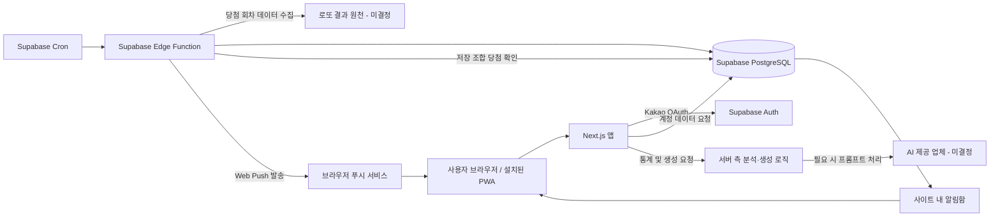

# 로또 분석 서비스 아키텍처 초안

상태: 검토용 초안 · 기능 구현 전

## 1. 선택한 접근

### 고려한 대안

| 접근 | 이점 | 비용 및 제약 | 결정 |
|---|---|---|---|
| Next.js + Supabase | 웹/PWA, Kakao OAuth, PostgreSQL, 정기 작업을 적은 운영 구성으로 연결 | 인증·DB·작업을 Supabase 방식에 맞춰 구성 | 선택 |
| Vite + React + Supabase | 프론트엔드 중심으로 단순하게 시작 | 서버 렌더링과 서버 전용 데이터 처리 경로를 별도로 설계해야 할 수 있음 | 미선택 |
| Next.js + NestJS + PostgreSQL | 서버 로직과 작업 스케줄을 직접 제어 | 프론트·백엔드 배포와 운영 부담이 커짐 | 미선택 |

선택 이유: 초기에는 PWA와 데이터 중심 기능을 빠르게 함께 구성하는 것이 중요하다. Supabase는 Kakao OAuth와 PostgreSQL 기반 정기 작업을 제공하며, Next.js는 PWA와 Web Push 구현 가이드를 제공한다.

## 2. 기술 구성

- **웹앱:** Next.js App Router, React, TypeScript
- **UI:** shadcn/ui + Tailwind CSS, Lucide 아이콘
- **클라이언트 전역 상태:** Zustand (모달, 선택 중인 번호, 화면 상태 등 임시 UI 상태)
- **브라우저 서버 상태:** TanStack Query (캐시·갱신·mutation이 필요한 클라이언트 데이터)
- **요청:** Supabase JS SDK와 SSR 세션용 `@supabase/ssr`, Web `fetch`; Axios는 인터셉터 등 구체적인 요구가 생기면 재검토
- **검증:** Zod
- **정적 검사와 포맷:** ESLint + Prettier
- **단위/컴포넌트 테스트:** Vitest + React Testing Library + `user-event`
- **인증·DB·예약 작업:** Supabase Auth, PostgreSQL, Cron, Edge Functions
- **PWA 푸시:** Web App Manifest, Service Worker, Web Push/VAPID
- **날짜:** 기본 `Intl.DateTimeFormat`; 필요한 경우 `date-fns`

TanStack Query는 모든 서버 데이터를 무조건 소유하지 않는다. 공개 주간 분석은 Next.js Server Component에서 읽을 수 있고, 클라이언트에서 캐시·갱신이 필요한 경우 TanStack Query를 적용한다. 같은 데이터를 서버 컴포넌트와 Query 캐시가 중복 소유하지 않도록 한다.

로그아웃 사용자는 공개 랜덤 번호 생성 화면만 사용한다. 이 화면은 통계·AI·Supabase 계정 데이터에 접근하지 않으며, 생성 결과의 숫자 공 애니메이션은 첫 번째 번호부터 여섯 번째까지 순서대로 멈추게 한다. 랜덤 조합을 클라이언트에서 만들지 서버 API에서 만들지는 구현 단계에서 정한다.

## 3. 구성도

## 4. 데이터 흐름

### 인증 및 사용자 데이터

1. 브라우저에서 Supabase Auth의 Kakao OAuth 흐름을 PKCE 방식으로 시작한다.
2. `/auth/callback` Route Handler가 코드를 세션으로 교환하고 쿠키에 저장한 뒤 홈으로 돌아온다.
3. Next.js 16 `src/proxy.ts`가 `auth.getClaims()`로 세션을 갱신하고, 서버 컴포넌트는 검증된 claims로 로그인 상태를 표시한다. Proxy는 계정 데이터의 권한 검사를 대신하지 않는다.
4. 로그인 후 사용자별 데이터는 Supabase PostgreSQL에 저장한다.
5. Row Level Security 정책으로 사용자의 저장 조합, 프롬프트, 푸시 구독, 알림 내역을 본인 계정에 한정한다.

### 주간 결과 수집

1. Supabase Cron이 한국 시간 기준 토요일 오후 10시 무렵 Edge Function을 호출한다.
2. Edge Function이 선정된 데이터 원천에서 회차 번호, 당첨 번호, 보너스 번호, 등수별 당첨금을 가져온다.
3. 데이터는 회차 키를 기준으로 중복 삽입 없이 저장한다.
4. 데이터 저장 후 해당 회차에 연결된 미확인 저장 조합만 대조하고 결과를 기록한다. 완료된 조합은 이후 회차에서 다시 대조하지 않는다.
5. 당첨 조합에 대해 알림 내역을 만들고, 활성 푸시 구독에 알림을 보낸다.
6. 작업 성공 시각과 상태를 기록해 사용자에게 예상 시각 및 마지막 갱신 정보를 표시한다.

데이터 원천과 결과 정정 처리 절차가 아직 결정되지 않아 수집 어댑터와 재시도 규칙은 후속 결정이 필요하다.

### 분석 및 생성

- 통계 지표의 계산은 검증 가능한 명시적 로직으로 수행한다.
- AI는 승인된 범위 안에서 자유 프롬프트 해석과 결과 설명을 담당하는 후보 구조로 둔다. AI 제공 업체, 모델, 비용 한도, 출력 검증은 미결정이다.
- 조합 생성기는 1~45 범위의 번호 6개 조합을 생성하고, 사용자 고정 번호와 생성 조건을 검증한다.
- 생성 시점의 데이터 회차, 통계 기간, 선택 프롬프트, 적용 조건, 결과 요약을 저장해 생성 기록을 재현할 수 있도록 하는 방안을 제안한다. 보존 범위는 검토가 필요하다.
- 전체 자동 모드는 사용자가 고정 번호를 선택하지 않는 자동 생성으로 해석했다. 이 해석은 승인 대기다.

### 순차 시뮬레이션

- 회차 `n`의 테스트 조합은 `n` 이전 데이터만으로 통계와 조건을 산출해 생성한다.
- 생성 결과를 실제 회차 `n`의 번호와 비교해 합치 번호 수, 등수 또는 당첨금 기준 성적을 기록한다.
- 시작 회차, 과거 데이터 창, 매 회차 조합 수, 저장 프롬프트 적용 규칙, 결과 지표는 미결정이다.

## 5. 주요 데이터 개체 초안

- `profiles`: Supabase Auth 사용자와 연결되는 프로필
- `lottery_draws`: 회차별 추첨 일시, 당첨 번호, 보너스 번호, 등수별 당첨금, 출처, 갱신 상태
- `saved_combinations`: 사용자 저장 조합, 저장 시 연결한 다음 회차, 해당 회차 대조 결과/완료 시각, 생성 방식, 생성 메타데이터
- `saved_prompts`: 사용자별 프롬프트 최대 5개
- `push_subscriptions`: 기기별 Web Push 구독 정보
- `notifications`: 사용자별 알림 내역 및 읽음 상태
- `simulation_runs` / `simulation_results`: 시뮬레이션 조건과 회차별 결과

필드 상세, 삭제 정책, 데이터 보존 기간은 미결정이다.

## 6. 운영 및 신뢰성

- 데이터 수집은 같은 회차에 여러 번 실행돼도 중복 결과가 생기지 않도록 설계한다.
- 수집 시각과 작업 결과를 기록하고 실패 및 늦은 결과를 화면에 반영한다.
- Web Push 구독은 기기 단위로 저장하고 만료/실패 구독을 비활성화한다.
- AI 비밀 키는 브라우저에 노출하지 않고 서버 측 환경에만 둔다.
- 로또 통계와 시뮬레이션에는 데이터 기준 회차와 기간을 표시한다.
- 인증 제공자, 푸시, AI 및 데이터 원천의 외부 의존성과 비용은 선택 후 다시 검토한다.

## 7. 미결정 기술 항목

1. 로또 결과 데이터 원천 및 이용 조건
2. AI 제공 업체, 모델, 데이터 전송 범위, 비용 상한 및 실패 처리
3. 서버 측 분석/생성 로직을 Next.js Route Handler와 Supabase Edge Function 중 어디에 둘지
4. Supabase 배포 지역, 운영 환경 및 실제 프로젝트 구성
5. 통계 및 시뮬레이션 기본 기간과 정량 지표
6. 결과 정정, 재수집 및 푸시 재전송 정책
7. 생성 기록 및 시뮬레이션의 보존·삭제 정책
8. 전체 자동 모드의 정확한 동작 해석
